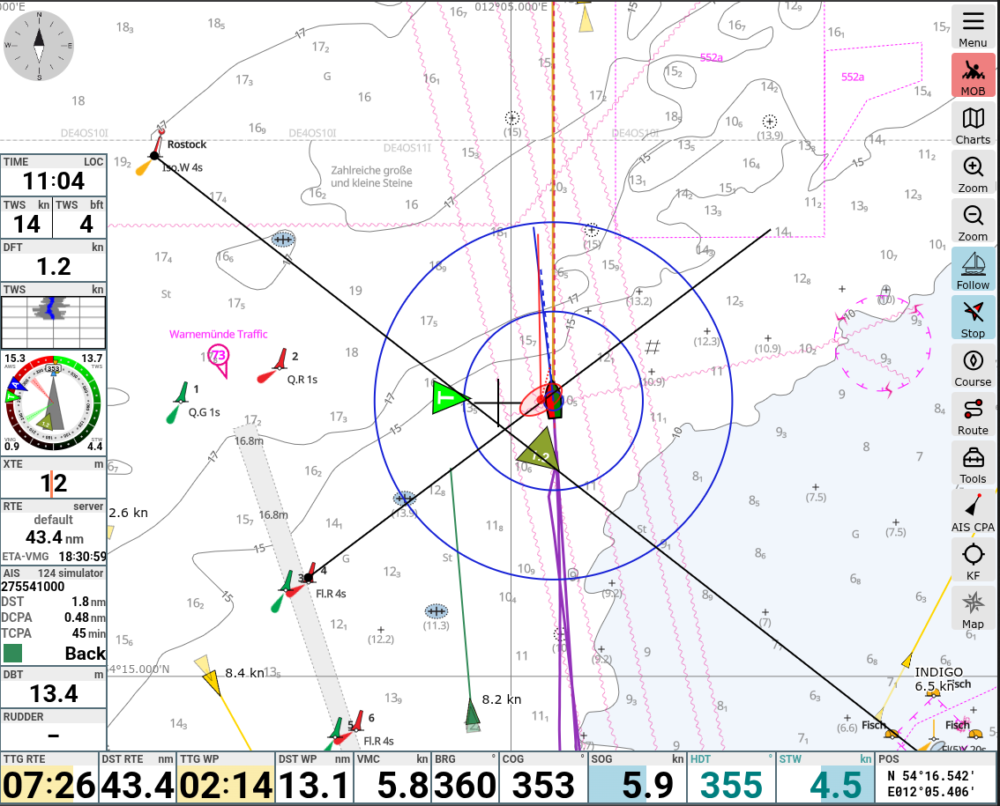

# Dead Reckoning Plugin for AvNav

The Kalman Filter plugin estimates the boat's position, course and speed. It uses an [iterated extended Kalman filter (iEKF)](https://en.wikipedia.org/wiki/Extended_Kalman_filter), combining motion data with GPS fixes and observations you enter on the chart. When recent GPS positions are available, it follows them; when they stop, it continues in dead-reckoning mode.

## 4D-model and 6D-model

Choose between them with **Use log and compass** in the plugin settings:

- **4D-model** (**Use log and compass** off; manual): Uses position and ground velocity. You can enter a fix and update course and speed from the chart dialog; no log or compass is required.
- **6D-model** (**Use log and compass** on; log and compass): Uses water speed from the log and heading from the compass, and estimates current as well as position. In dead-reckoning mode, chart fixes, bearings and ranges help correct the estimate. The compass needs to supply true heading.

The displayed current (**SET/DFT**) is inferred from the difference between ground motion (COG/SOG, inferred from absolute references such as GPS position fixes and charted-object bearings/ranges) and water motion (heading/speed from the compass/log). It is a residual estimate, not a direct current measurement: it can include actual current as well as leeway and sensor or model offsets and errors.

## Install

1. Upload the plugin ZIP from releases on AvNav's **Plugins** page. NumPy must be installed in AvNav's Python environment.
2. Add the **KalmanFilter** map overlay: **Layout → Edit → On map → Add KalmanFilter**. The overlay displays the estimate and plotted observations.

## Configure

### Plugin settings

- **Use log and compass**: Selects the **4D-model** when off or the **6D-model** when on.
- **Log fail**: Sets a water-speed threshold in knots for detecting a failed log. When the log reports zero while the filter's estimated water speed exceeds this threshold, the zero reading is ignored. Set to `0` to disable detection.
- **Noise V**: Controls process noise for motion. Larger values let the estimate adapt faster but increase uncertainty.
- **Noise W**: In the **6D-model**, controls process noise for the estimated current. Larger values let the estimate adapt faster but increase uncertainty.
- **Measurement errors**: Set the assumed errors to suit your instruments and observations:
  - **Position** and **Range error**: metres.
  - **Speed**: knots.
  - **Course** and **Bearing**: degrees.
- **Interval**: Sets the filter loop interval.
- **Speedup**: Accelerates the filter's clock for simulation and testing; leave at `1` for normal use.
- **Talker ID** and **Priority**: Set the NMEA talker prefix and source priority.

### Map overlay settings

- **Confidence level**: Sets the covariance ellipse confidence from 0–100%; set it to `0` to hide the ellipse.
- **Overlay color**: Sets the color of the estimate and graphics.
- **Show labels**: Toggles labels on plotted observations; on by default.
- **COG vector**: Toggles the ground-velocity vector; on by default.
- **CTW vector**: Toggles the water-velocity vector; off by default.
- **DFT vector**: Toggles the estimated current vector; on by default.

### NMEA output and diagnostics

Keep the NMEA output priority below that of your real GPS source so the estimate does not take precedence over GPS data.

- In dead-reckoning mode, the filter outputs an RMC sentence, including in the **4D-model**.
- In the **6D-model**, it also outputs a VDR sentence for estimated current.
- NMEA output is suppressed when **GPS off** is selected.
- For backend diagnostic logging, set the plugin process environment variable `DEV=1`; output is suppressed by default.

## Use

The plugin publishes its estimate under `gps.kalman.*`, which you can use in AvNav widgets.

### Check the filter state

The **KF** button icon indicates the filter's current mode, and the **KF** dialog describes it:

-  **OFF**: The filter is not initialized. Provide a position fix to start it.
-  **GPS**: Locked to recent GPS positions; chart observations are plotted but do not affect the estimate.
-  **DR**: Dead reckoning with the 6D model. Chart observations update the estimate by default.
-  **DRM**: Dead reckoning in manual mode with the 4D model. The dialog allows manual course and speed entry (C/S).

**GPS off** simulates GPS loss by withholding GPS position and ground course/speed from the filter. Log and compass input, if selected, continues to be used.

### Enter chart observations

1. Add the **KalmanFilter** overlay.
2. Center the charted object before opening **KF**. The chart center is captured when the dialog opens.
3. Bearing and range fields are available in GPS-lock and dead-reckoning modes. They are prefilled with the bearing and range from AvNav’s current boat position to the chart center when that position is available. If magnetic variation is available, the dialog also offers a **magnetic** checkbox and pre-fills the bearing as magnetic; otherwise bearings are true.
4. Choose an action:
   -  **Fix**: Uses the chart center as the boat's observed position, for example when close to a buoy or other known object. Available before initialization and in dead-reckoning mode, but not while locked to GPS; a marker is drawn at the fix location.
   -  **BRG**: Enter the bearing to the centered object. Select **magnetic** for a magnetic bearing; when updating the filter, the plugin converts it to true before submission. In dead-reckoning mode the bearing is used as a filter observation; successive bearings can be used for cross-bearings or running fixes.
   -  **RNG**: Enter the measured range and submit it. The overlay draws a range arc around the prefilled bearing (or the bearing entered in the dialog).
   -  **BRG+RNG**: Submit bearing and range together. Select **magnetic** if needed; when updating the filter, the plugin converts the bearing to true before submission. The overlay draws the bearing line and a narrow range arc.
   -  **C/S** (**4D-model**): In manual dead-reckoning mode, enter course over ground (true) and speed over ground. The button is available after initialization in that mode.

In GPS lock, **BRG**, **RNG** and **BRG+RNG** only plot observations on the chart. In dead-reckoning mode they update the filter by default. The **update filter** setting is enabled by default; disable it to plot bearing/range observations on the chart without applying them to the filter.

With **Show labels** enabled, plotted markers include their entry time, and bearing/range markers also show the entered values; bearing labels are marked **M** or **T** for magnetic or true. The overlay retains up to 20 recent markers.

### Reset and clear markers

-  **Reset** restarts the filter and clears plotted markers.
-  **Cleanup** clears observation markers from the overlay; it does not undo observations already incorporated by the filter.
